# Invoice Intelligence Platform

[](https://github.com/shreyescodes/Invoice-Intelligence-Platform/actions/workflows/ci.yml)


[](LICENSE)

Accounts-payable automation for supplier invoices. Every invoice that arrives is read, matched against
the ERP's purchase order and goods receipt, checked for duplicates and arithmetic errors, scored for
anomalies against the vendor's own history, and then either **approved and posted to the ERP
automatically** or **routed to an approver with the exact reasons it was stopped**.

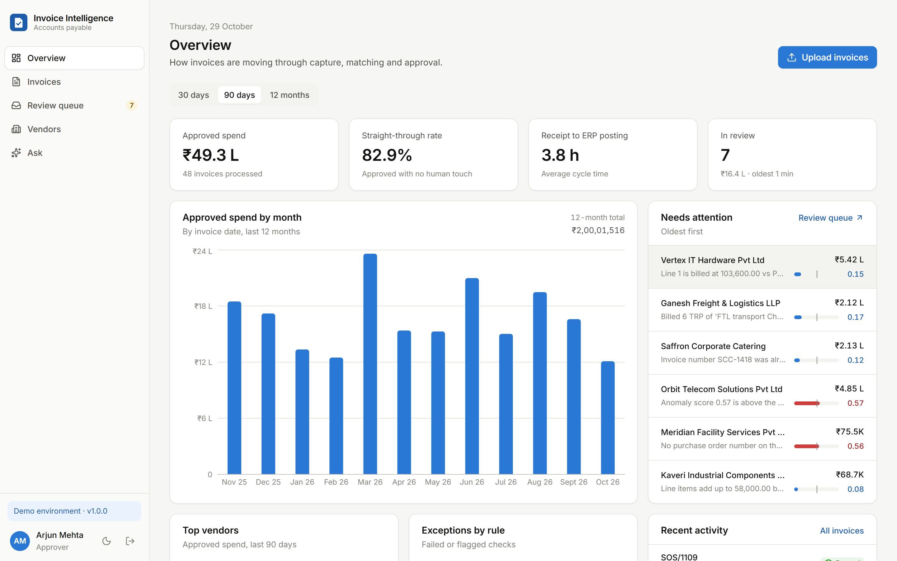

---

## Contents

- [What it does](#what-it-does)
- [Screenshots](#screenshots)
- [Architecture](#architecture)
- [Quick start](#quick-start)
- [Demo walkthrough](#demo-walkthrough)
- [Configuration](#configuration)
- [Development](#development)
- [Project layout](#project-layout)
- [Engineering notes](#engineering-notes)
- [Limitations](#limitations)

## What it does

| Stage | What happens | Where |
|---|---|---|
| **Capture** | PDF text layer and ruled tables are parsed into header fields and line items, each with a confidence score. Fields that agree with each other (lines sum to the subtotal, subtotal + tax = total) are cross-checked. Low-confidence documents can be refined by an LLM, and scanned images can go through Azure AI Document Intelligence. | [`extraction/`](backend/app/services/extraction) |
| **Vendor match** | The vendor is resolved against a local replica of the ERP supplier master by GSTIN, falling back to fuzzy name matching (flagged as a warning). | [`vendors.py`](backend/app/services/vendors.py) |
| **Validation** | Ten rules: required fields, vendor master, duplicates (normalised invoice number, or same amount within a week), line totals, invoice total, GST slab, dates, PO reference, **2-way price match** and **3-way goods-receipt match** against quantities received but not yet invoiced. | [`validation.py`](backend/app/services/validation.py) |
| **Risk scoring** | An Isolation Forest scores vendor-relative features (amount vs. the vendor's median, tax-rate drift, re-billing gaps, round sums). The score is calibrated to 0–1 and always comes with plain-language reasons. | [`anomaly.py`](backend/app/services/anomaly.py) |
| **Policy** | Auto-approve only if every check passed, the amount is under the auto-approval limit, extraction is confident and the risk is low. Otherwise the invoice goes to review. | [`policy.py`](backend/app/services/policy.py) |
| **Approval** | Approvers decide in the UI. Segregation of duties (nobody approves an invoice they uploaded), approval limits by role, optimistic locking against double decisions, and a full audit trail. | [`invoices.py`](backend/app/services/invoices.py) |
| **ERP posting** | Approved invoices are posted to the ERP with an idempotency key, so retries can never double-book. Transient failures retry with exponential backoff; business rejections park the invoice for an operator. | [`pipeline.py`](backend/app/services/pipeline.py) |
| **Analytics** | KPI dashboard (spend, straight-through rate, cycle time, exceptions) and an **Ask** page that answers questions with read-only SQL, curated or LLM-generated, behind an AST-level guard. | [`analytics.py`](backend/app/services/analytics.py), [`ask.py`](backend/app/services/ask.py) |

## Screenshots

Every image below was captured by [a Playwright script](frontend/e2e/screenshots.spec.ts) that drives
the real application against a freshly seeded stack. Nothing is mocked up.

| | |
|---|---|
| 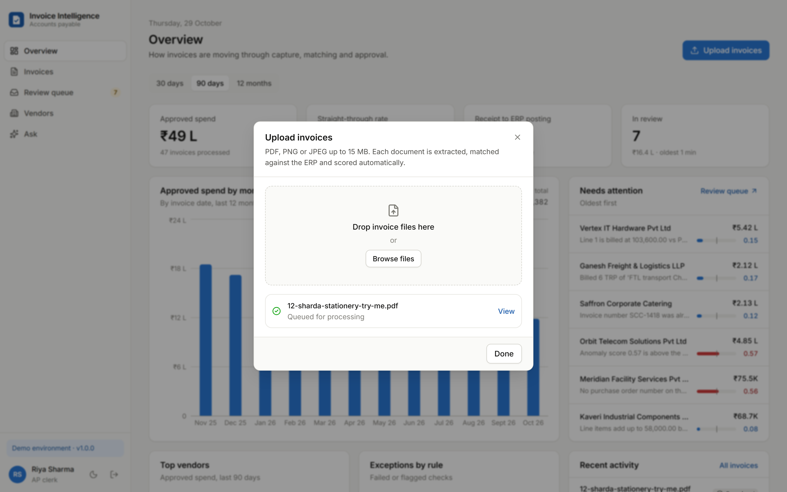 **Upload.** Drag and drop PDFs; each one is queued and processed in the background. | 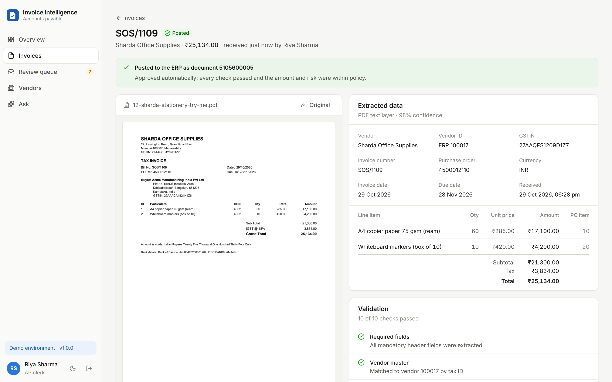 **Straight-through.** A clean invoice is matched to its PO, auto-approved and posted to the ERP within seconds. |
| 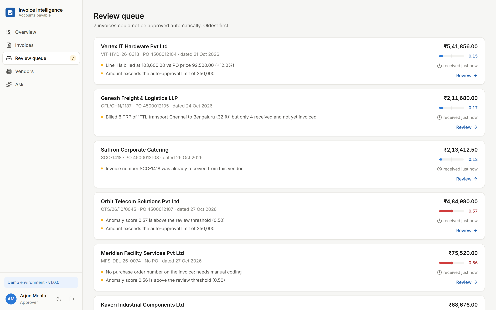 **Review queue.** Exceptions, oldest first, each with the reasons it was stopped and its risk score. | 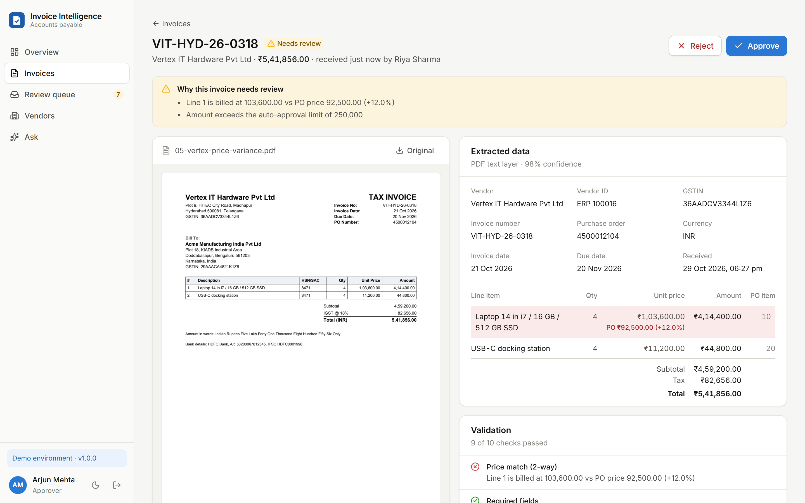 **Price variance.** Laptops billed 12% above the PO price, shown beside the rendered document. |
| 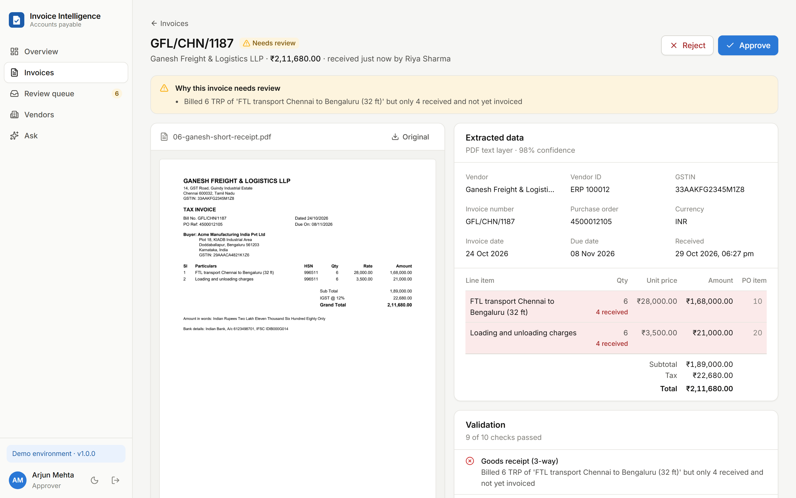 **3-way match.** Six trips billed, four received: the affected lines are highlighted. | 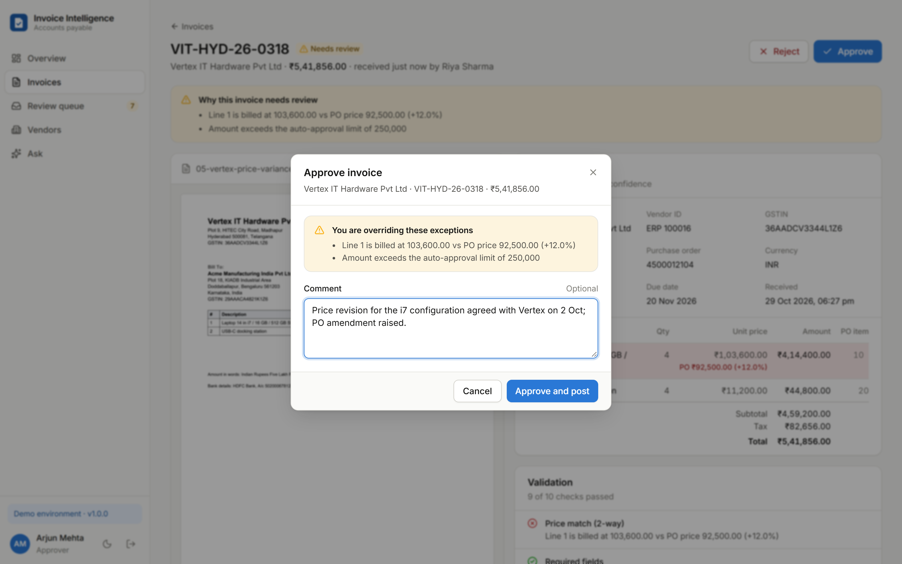 **Override with a reason.** Approving an exception shows what is being overridden and records the comment. |
| 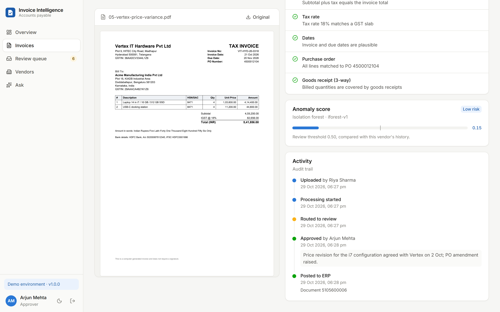 **Audit trail.** Every state change, actor and ERP document number. | 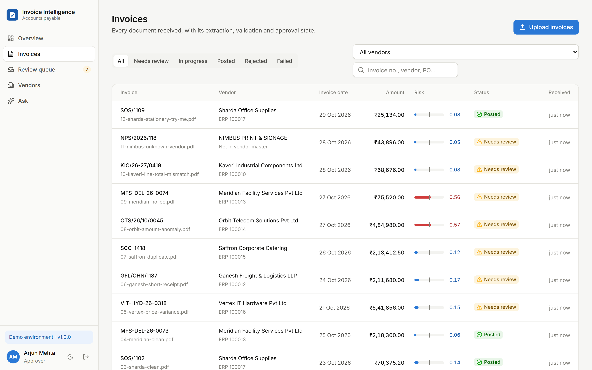 **Invoices.** Filter by status and vendor, search, page; rows refresh while invoices are in flight. |
| 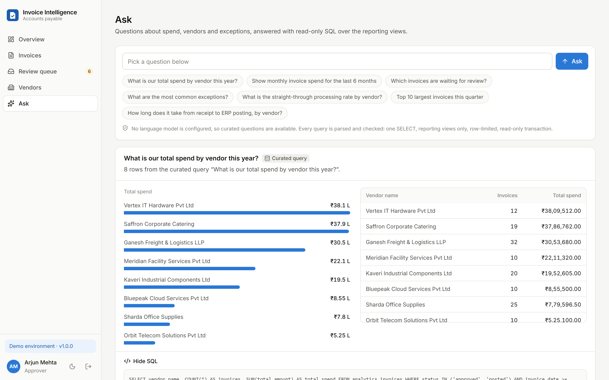 **Ask.** Natural-language questions answered with guarded, read-only SQL (shown on demand). | 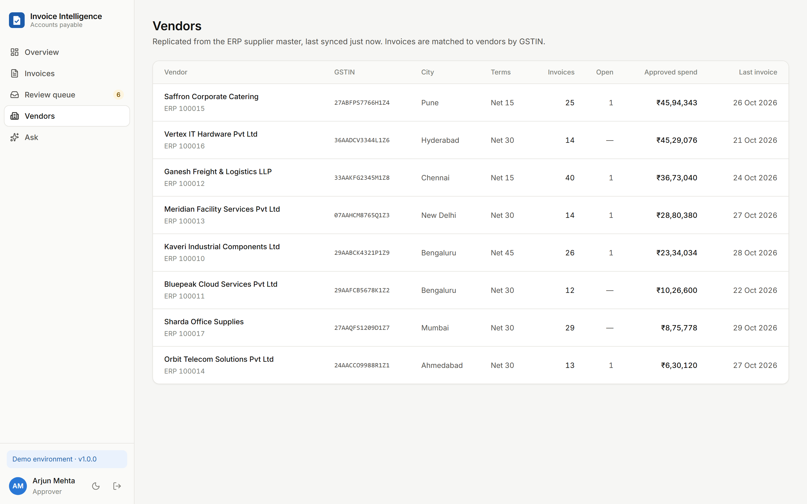 **Vendors.** Supplier master replicated from the ERP, with spend and open items. |
| 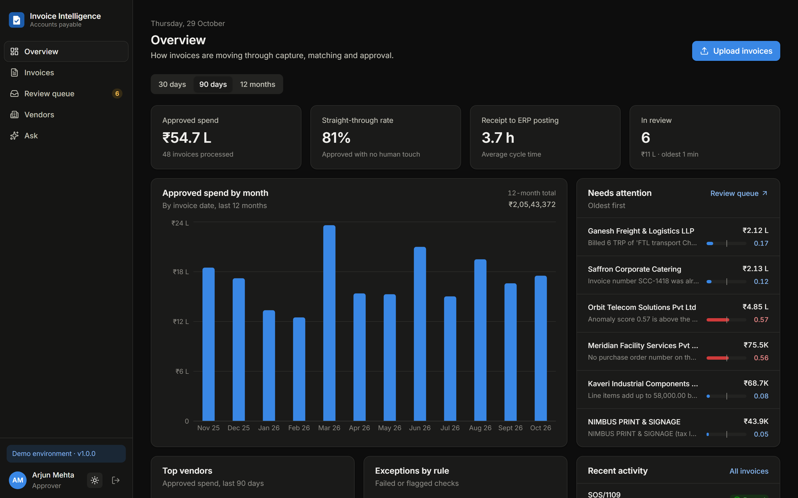 **Dark theme.** Every colour is a design token with its own dark value. | 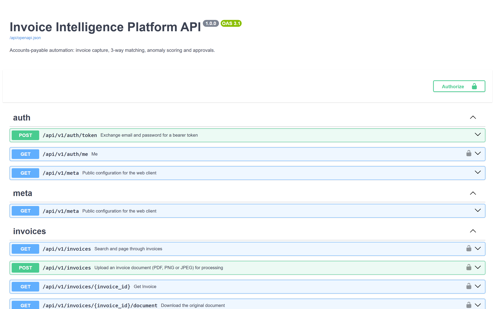 **API.** Typed OpenAPI 3.1 contract; the frontend's client is generated from it. |

<details>
<summary>Sign-in screen</summary>

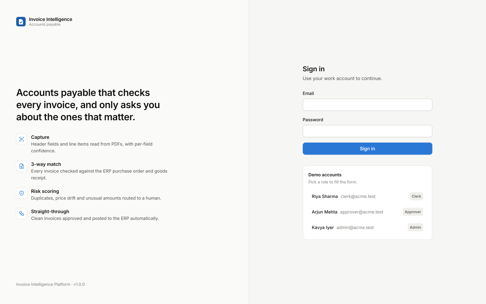
</details>

## Architecture

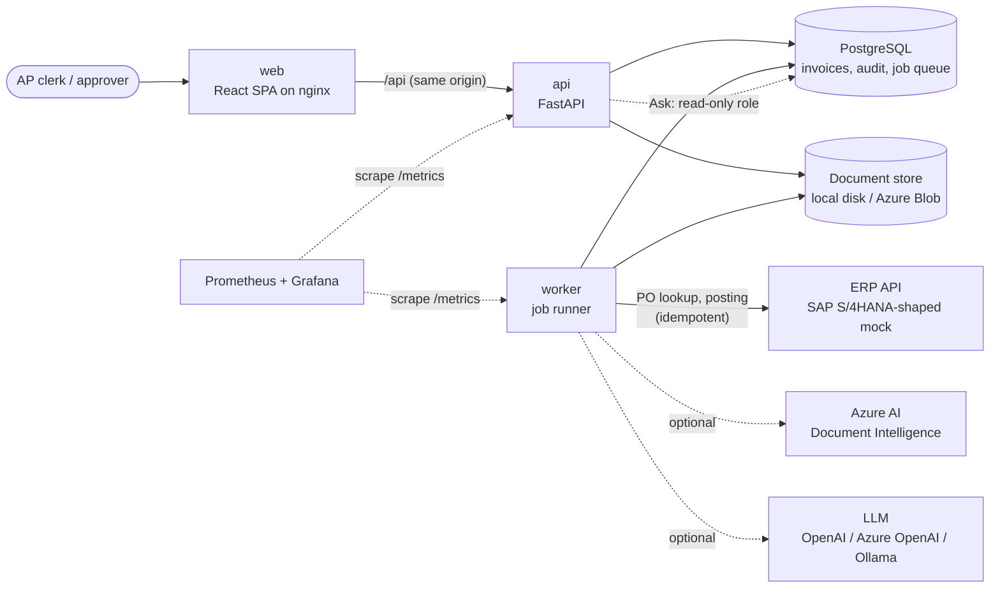

- **One relational database, one queue.** Invoices, line items, check results, the audit trail and the
  job queue all live in PostgreSQL. A job is inserted in the same transaction as the state change that
  needs it (a transactional outbox), and workers claim jobs with `FOR UPDATE SKIP LOCKED`, so you can
  run any number of replicas. See [ADR 0002](docs/adr/0002-database-job-queue.md).
- **The API never blocks on slow work.** Uploads return `202 Accepted` and the UI polls while an
  invoice is in flight; extraction, ERP calls and scoring all happen in the worker.
- **Adapters at the edges.** Storage (local / Azure Blob), extraction (PDF text / Azure Document
  Intelligence), LLM (any OpenAI-compatible endpoint) and the ERP client are swappable through
  configuration; the core pipeline doesn't know which one it is talking to.

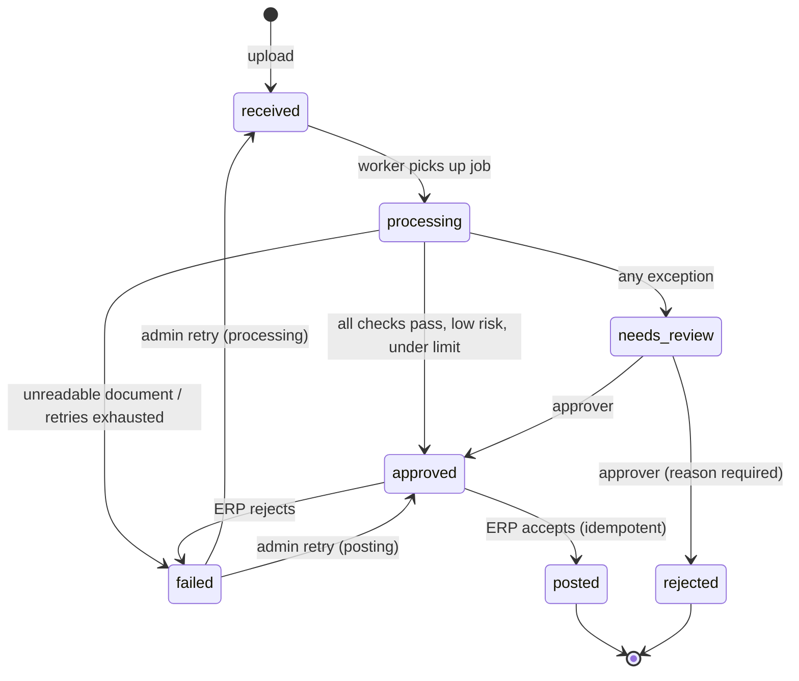

More detail on the data model, rules and guardrails is in [docs/architecture.md](docs/architecture.md).

## Quick start

### With Docker (recommended)

```bash
git clone https://github.com/shreyescodes/Invoice-Intelligence-Platform.git
cd Invoice-Intelligence-Platform
docker compose up --build
```

Open **http://localhost:8080** and sign in with one of the demo accounts (they're also listed on the
sign-in screen):

| Role | Email | Password | Can |
|---|---|---|---|
| AP clerk | `clerk@acme.test` | `clerk-demo-pass` | upload, view |
| Approver | `approver@acme.test` | `approver-demo-pass` | approve or reject up to ₹10 L |
| Admin | `admin@acme.test` | `admin-demo-pass` | approve any amount, retry failed invoices |

On first start, compose runs the migrations and the demo seed (users, the vendor master from the ERP,
a year of invoice history, and 11 fresh invoices that go through the live pipeline). The API docs are
at http://localhost:8080/api/docs.

Optional profiles:

```bash
docker compose --profile observability up   # + Prometheus :9090 and a provisioned Grafana dashboard :3000
docker compose --profile llm up -d ollama && docker compose exec ollama ollama pull qwen2.5-coder:7b
LLM_PROVIDER=openai docker compose --profile llm up   # free-form questions on the Ask page
```

### Without Docker

Needs Python 3.12, [uv](https://docs.astral.sh/uv/) and Node 22. SQLite is used by default.

```bash
# 1. Mock ERP (terminal 1)
cd erp-mock && uv sync && uv run uvicorn erp_mock.main:app --port 8100

# 2. API with an in-process worker (terminal 2)
cd backend && uv sync --all-extras
export DEMO_MODE=true EMBEDDED_WORKER=true          # PowerShell: $env:DEMO_MODE="true"; ...
uv run iip migrate && uv run iip seed --process
uv run uvicorn app.main:app --port 8000

# 3. Web app (terminal 3)
cd frontend && npm ci && npm run dev                 # http://localhost:5173
```

## Demo walkthrough

The seed uploads these invoices through the real pipeline. The PDFs are in
[`samples/invoices/`](samples/invoices), and `12-sharda-stationery-try-me.pdf` is left for you to
upload yourself.

| Invoice | What's wrong | Caught by | Outcome |
|---|---|---|---|
| Kaveri, Bluepeak, Sharda, Meridian | nothing | all checks pass | auto-approved, posted |
| Vertex `VIT-HYD-26-0318` | laptops billed 12% above PO price | 2-way price match | review |
| Ganesh `GFL/CHN/1187` | 6 trips billed, 4 received | 3-way goods receipt | review |
| Saffron `SCC-1418` | invoice number already paid | duplicate check | review |
| Orbit `OTS/26/10/0045` | about 9× the vendor's usual amount | anomaly model, auto-approval limit | review |
| Meridian `MFS-DEL-26-0074` | no PO reference | PO check, anomaly model | review |
| Kaveri `KIC/26-27/0419` | subtotal printed ₹200 higher than the lines | line totals | review |
| Nimbus `NPS/2026/118` | vendor not in the master, no PO | vendor match, PO check | review |

Things to try: sign in as the **clerk** and notice you can't approve; as the **approver**, approve the
Vertex invoice and watch it post to the ERP; try to approve something you uploaded yourself; run
`ERP_FAILURE_RATE=0.5 docker compose up erp` and watch the retries in the audit trail.

## Configuration

Settings are environment variables (or a `.env` file in `backend/`); the full list with defaults is
in [`backend/app/config.py`](backend/app/config.py). The important ones:

| Variable | Default | Purpose |
|---|---|---|
| `DATABASE_URL` | `sqlite:///./data/iip.db` | SQLAlchemy URL; `postgresql+psycopg://…` in every deployed environment |
| `ANALYTICS_DATABASE_URL` | — | Connection for the Ask page; point it at a role that can only read the `analytics_*` views |
| `JWT_SECRET` | dev value | Token signing key; **required** (≥ 32 chars) when `ENVIRONMENT=production` |
| `STORAGE_BACKEND` | `local` | `local` or `azure_blob` (`AZURE_STORAGE_ACCOUNT_URL`, managed identity) |
| `EXTRACTOR` | `pdf_text` | `pdf_text` or `azure_document_intelligence` (`AZURE_DI_ENDPOINT`) |
| `LLM_PROVIDER` | `none` | `openai` (any OpenAI-compatible URL via `LLM_BASE_URL`) or `azure_openai` |
| `ERP_BASE_URL` / `ERP_API_KEY` | mock | ERP API location and credentials |
| `AUTO_APPROVE_LIMIT` | `250000` | Largest invoice that may be approved without a human |
| `APPROVER_LIMIT` | `1000000` | Largest invoice an approver (not admin) may approve |
| `ANOMALY_REVIEW_THRESHOLD` | `0.5` | Risk score at which an invoice goes to review |
| `PRICE_TOLERANCE_PCT` | `2.0` | Allowed unit-price deviation from the PO |
| `EMBEDDED_WORKER` | `false` | Run the worker inside the API process (single-process setups) |
| `DEMO_MODE` | `false` | Show demo accounts on the sign-in page; refused in production |

## Development

```bash
cd backend
uv run pytest                 # 119 tests; set TEST_DATABASE_URL to run them against PostgreSQL
uv run ruff check . && uv run ruff format --check .
uv run mypy app               # strict mode

cd frontend
npm test                      # Vitest
npm run lint && npm run typecheck
npm run e2e                   # Playwright smoke tests against a running stack
npm run screenshots           # regenerate docs/screenshots against a freshly seeded stack
npm run gen:api               # regenerate TypeScript types from openapi.json
```

[CI](.github/workflows/ci.yml) runs the backend suite on **both PostgreSQL and SQLite**, checks that the
committed OpenAPI contract and generated client types are in sync, lints and builds the frontend,
compiles the Bicep templates, and runs the Playwright smoke tests against the full `docker compose`
stack.

## Project layout

```
backend/              FastAPI app, worker and CLI (one image, three roles)
  app/api/            HTTP routes and dependencies (auth, roles)
  app/services/       extraction, validation, anomaly model, policy, pipeline, ERP client, analytics
  app/demo/           invoice PDF renderer and demo seed
  migrations/         Alembic migrations (schema + analytics views)
  tests/              unit, API and end-to-end pipeline tests
erp-mock/             SAP S/4HANA-shaped supplier / PO / supplier-invoice API with idempotent posting
frontend/             React 19 + TypeScript + Tailwind v4 SPA, nginx config, Playwright specs
infra/                Bicep: Azure Container Apps, PostgreSQL Flexible Server, Blob, Key Vault, ACR
deploy/               Postgres init, Prometheus rules, Grafana dashboard
docs/                 architecture, deployment and operations, ADRs, screenshots
samples/invoices/     the demo PDFs
```

## Engineering notes

- **Money is never a float.** `Decimal` with `NUMERIC(14,2)` columns end to end; the API serialises
  amounts as fixed-point strings.
- **Untrusted input everywhere.** File types are sniffed from magic bytes, not the client's
  `Content-Type`; storage keys are generated server-side; LLM-written SQL is parsed into an AST and
  must be a single `SELECT` over allowlisted views before it runs in a `READ ONLY` transaction with a
  statement timeout ([ADR 0003](docs/adr/0003-guarded-text-to-sql.md)).
- **Exactly-once effects on top of at-least-once jobs.** ERP postings carry an idempotency key (the
  invoice id), and handlers check the current state before acting, so a retried job is harmless.
- **Explainable automation.** Every automated decision stores its reasons (failed checks, risk drivers,
  policy limits), and every state change writes an audit event with the actor.
- **Operability.** Structured JSON logs with request ids, Prometheus metrics for HTTP, the pipeline,
  the queue and ERP calls, alert rules, liveness and readiness probes, and stale-lock recovery for
  crashed workers. See [docs/operations.md](docs/operations.md).
- **Typed contract.** The frontend's API types are generated from the backend's OpenAPI document, and
  CI fails if either side drifts.

Architecture decision records: [0001 PostgreSQL instead of Cosmos DB + Snowflake](docs/adr/0001-single-postgres-database.md) ·
[0002 database-backed job queue](docs/adr/0002-database-job-queue.md) ·
[0003 guarded text-to-SQL](docs/adr/0003-guarded-text-to-sql.md) ·
[0004 pluggable extraction](docs/adr/0004-pluggable-extraction.md)

## Limitations

- The anomaly model ships trained on **synthetic** invoice streams (precision 0.98, recall 0.70,
  ROC-AUC 0.995 on a held-out synthetic set with 6% injected anomalies). Retrain on real history with
  `iip train-anomaly --from-db` once you have a few hundred approved invoices.
- The built-in extractor reads the PDF text layer. Scanned documents need the Azure Document
  Intelligence extractor (or another OCR adapter) and otherwise go to review.
- The ERP is a mock that mirrors the shape of SAP's supplier, purchase-order and supplier-invoice APIs;
  a real integration would replace `ErpClient`'s base URL and authentication.
- Login throttling is per API process. Put a shared store or the edge WAF in front for stricter limits.
- Authentication is local accounts with JWTs; single sign-on (Entra ID / OIDC) is the natural next step.

## License

[MIT](LICENSE)
