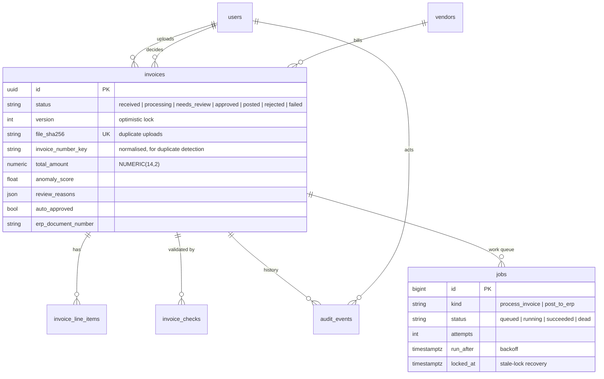
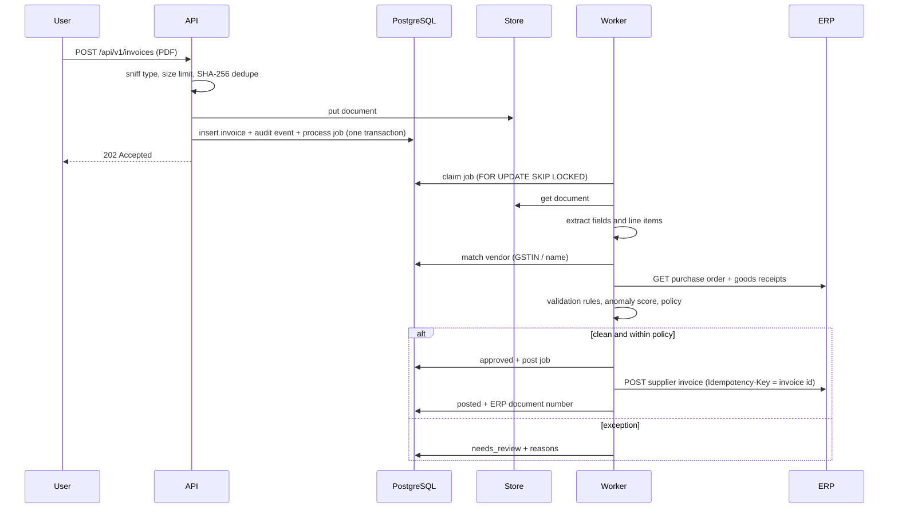

# Architecture

This document covers how the platform is put together and why. For running and deploying it, see
[operations.md](operations.md).

## Components

| Component | Runtime | Responsibility |
|---|---|---|
| `web` | nginx serving the React build | UI; proxies `/api` to the API on the same origin, so there is no CORS in deployed environments. Strict CSP, no inline scripts. |
| `api` | FastAPI on uvicorn | Authentication, uploads, queries, approval commands, analytics. Stateless; scale horizontally. |
| `worker` | `iip worker` (same image as the API) | Runs jobs: document processing and ERP posting. Replicates the vendor master, requeues jobs from crashed workers, exports queue metrics. |
| `migrate` | `iip migrate` | Alembic migrations, run once per release before new code starts. |
| PostgreSQL | 16 | System of record: invoices, line items, check results, audit trail, users, vendors, job queue, reporting views. |
| Document store | local disk or Azure Blob | Original documents and cached page previews, keyed by generated ids. |
| ERP | SAP S/4HANA-shaped API (mocked here) | Supplier master, purchase orders with goods receipts, supplier-invoice posting. |

The API and the worker are the same Python package (`backend/app`). Request handlers only do quick,
transactional work; anything slow or external (parsing PDFs, calling the ERP, scoring) happens in the
worker.

## Data model

All timestamps are stored as UTC `timestamptz` (normalised by a column type, so SQLite behaves the same
in tests). Money is `NUMERIC(14,2)` and `Decimal` in Python; quantities are `NUMERIC(14,3)`.

Four views (`analytics_invoices`, `analytics_line_items`, `analytics_checks`, `analytics_vendors`) form
the reporting surface. They are the only objects the read-only reporting role can see, and they leave
out credentials, raw document text and the job queue.

## Processing pipeline

### Extraction

`PdfTextExtractor` reads the PDF text layer with pdfplumber and uses ruled tables when it finds them.
`parse_invoice_text` then recognises labelled fields (invoice number, PO, dates, GSTIN, subtotal, tax
lines, totals) one line at a time, so a label never pairs with a value from the next line. Tax and
total lines are only read from the summary block, so a line item like "Tax advisory services" is never
counted as tax.

Each field gets a confidence: 0.95 when found next to a label, 0.65 for positional guesses, and 0.99
when independent fields agree (line items sum to the subtotal; subtotal + tax = total). The weighted
mean is the document's extraction confidence, and the policy requires 0.8 before it will auto-approve.

Below `LLM_REFINE_BELOW_CONFIDENCE`, an optional LLM re-reads the text and fills **only** the weak
fields. Values it supplies are marked at 0.85 confidence and re-cross-checked. See
[ADR 0004](adr/0004-pluggable-extraction.md).

### Validation rules

| Code | Fails when | Severity |
|---|---|---|
| `REQUIRED_FIELDS` | invoice number, date, total or vendor could not be read | fail |
| `VENDOR_MATCH` | GSTIN not in the vendor master (name-only match is a warning) | fail / warn |
| `DUPLICATE` | same vendor and normalised invoice number already received (same amount within 7 days is a warning) | fail / warn |
| `LINE_TOTALS` | lines don't add up to the subtotal, or qty × price ≠ amount | fail |
| `INVOICE_TOTAL` | subtotal + tax ≠ total (±₹1) | fail |
| `TAX_RATE` | effective rate is not a GST slab (0/5/12/18/28%) | warn |
| `DATES` | dated in the future, older than 180 days, or due before issue | warn |
| `PO_MATCH` | no PO, PO not found, or PO belongs to another supplier or currency | fail |
| `PRICE_MATCH` | unit price differs from the PO by more than `PRICE_TOLERANCE_PCT` | fail |
| `GOODS_RECEIPT` | billed quantity exceeds quantity received minus quantity already invoiced | fail |

Invoice lines are matched to PO lines by fuzzy description similarity, with a bonus for an identical
unit price. Any non-passing check blocks straight-through processing; warnings are shown with a
different severity but still need a human.

### Anomaly model

Features are relative to the vendor's own approved history (up to 24 invoices before this one), so one
unsupervised model serves vendors of very different sizes:

| Feature | Meaning |
|---|---|
| `log_amount` | log of the total |
| `amount_ratio_log` | log(total ÷ vendor median) |
| `amount_robust_z` | (total − median) ÷ MAD, clipped |
| `tax_rate`, `tax_rate_delta` | effective rate, and its distance from the vendor's usual rate |
| `days_since_last_log` | gap since the vendor's previous invoice |
| `round_amount` | total is a multiple of 1,000 |
| `line_count` | number of lines |

An `IsolationForest` (300 trees, 3% contamination) is trained on synthetic invoice streams with
injected anomalies: inflated amounts, wrong tax rates, rapid re-billing and round sums. Raw scores are
mapped through a sigmoid so that **0.5 is the contamination boundary** and a typical invoice scores
around 0.1. On a held-out synthetic set (1,200 invoices, 6% anomalous) it reaches **precision 0.98,
recall 0.70, ROC-AUC 0.995** at the 0.5 threshold. Reviewers never see only a number: `explain()`
turns the same features into sentences such as "Amount is 9.2x this vendor's median of 52,510".

`iip train-anomaly --from-db` retrains on the approved invoices in the database. The model file and
its metadata (features, calibration, evaluation) are versioned together.

### Approval policy and controls

- **Straight-through** only when every check passes, the risk score is below
  `ANOMALY_REVIEW_THRESHOLD`, the amount is within `AUTO_APPROVE_LIMIT` and extraction confidence is at
  least `MIN_EXTRACTION_CONFIDENCE`.
- **Segregation of duties:** the uploader of an invoice can never approve or reject it, admins included.
- **Delegation of authority:** approvers can approve up to `APPROVER_LIMIT`; anything above needs an admin.
- **Optimistic locking:** a `version` column makes two concurrent decisions on the same invoice
  impossible; the loser gets `409 Conflict`.
- **Audit trail:** every transition writes an `audit_events` row (actor, from/to status, comment,
  details) in the same transaction as the change.

## Job queue

See [ADR 0002](adr/0002-database-job-queue.md) for the reasoning. Mechanics:

1. The command that creates the work (upload, approval, retry) inserts a `jobs` row in its own
   transaction, so there is no "committed but never enqueued" window.
2. A worker claims the oldest runnable job with `SELECT … FOR UPDATE SKIP LOCKED LIMIT 1`, marks it
   `running` with a lock timestamp, and commits.
3. The handler runs in a fresh transaction. On success the job is marked `succeeded` in that same
   transaction.
4. On failure the transaction rolls back, and the job is rescheduled with exponential backoff and
   jitter (`WORKER_BACKOFF_BASE_SECONDS × 2^attempt`), up to `WORKER_MAX_ATTEMPTS`. Errors classed as
   permanent (unreadable document, ERP business rejection) skip the retries. A dead job parks its
   invoice in `failed` with the error and stage, and an admin can retry it from the UI.
5. Jobs left `running` past `WORKER_LOCK_TIMEOUT_SECONDS` (a crashed worker) are requeued.

The ERP client also retries transient errors (connection failures, 5xx, 429) a few times with short
backoff before giving up to the queue. Postings carry `Idempotency-Key: <invoice id>`, so a retry after
a timeout cannot double-book.

## Natural-language analytics

See [ADR 0003](adr/0003-guarded-text-to-sql.md). A question is answered from a catalogue of reviewed
queries when it matches one (fuzzy match), otherwise by an LLM when one is configured. Generated SQL
is parsed with sqlglot and must be exactly one `SELECT`/`UNION` with no DML, DDL, `SELECT INTO` or
locking clause. It may only reference the `analytics_*` views (CTEs allowed) and no `pg_*`, `dblink`,
`lo_*` and similar functions. A `LIMIT` is applied. The query then runs in a `READ ONLY` transaction
with a statement timeout, on a connection whose role can only read the views.

## Security

| Concern | Control |
|---|---|
| Passwords | Argon2id (argon2-cffi), rehashed on login when parameters change; constant-time path for unknown users |
| Sessions | HS256 JWT with audience and expiry; secret required and length-checked in production |
| Brute force | per-account lockout after repeated failures |
| Authorisation | role checks in dependencies, plus segregation of duties and limits in the service layer |
| Uploads | magic-byte sniffing, size limit, SHA-256 de-duplication, generated storage keys, path-traversal guard |
| Documents | served only to authenticated users with `nosniff` and `Content-Disposition` |
| SQL from LLMs | AST guard, view allowlist, read-only role and transaction, timeout, row limit |
| Secrets in Azure | Key Vault references resolved by a managed identity; no storage keys (`allowSharedKeyAccess: false`) |
| Browser | CSP without inline scripts, `X-Frame-Options: DENY`, `Referrer-Policy`, `Permissions-Policy` |
| Errors | RFC 9457 problem responses; no stack traces leave the server; a request id on every response |

## Observability

- **Logs:** structlog JSON, one event per line, with `request_id` bound for the whole request. Uvicorn's
  access log is replaced by a middleware log line with route template, status and duration.
- **Metrics** (`/metrics` on the API, `:9101/metrics` on the worker): HTTP requests and latency by
  route, uploads, pipeline outcomes and duration, job completions by result, queue depth, ERP calls by
  operation and result, approval decisions.
- **Alerts** ([`deploy/monitoring/alerts.yml`](../deploy/monitoring/alerts.yml)): API error rate,
  p95 latency, queue backlog, dead-lettered jobs, ERP unavailability.
- **Health:** `/health/live` (process up) and `/health/ready` (database and document store reachable).
